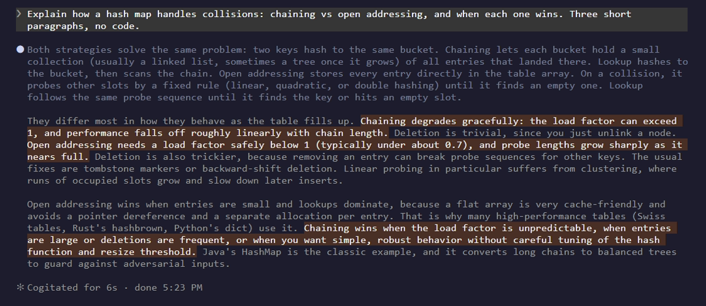
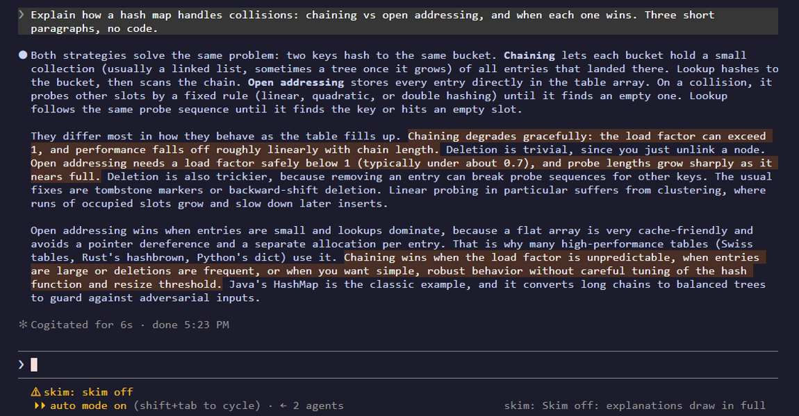
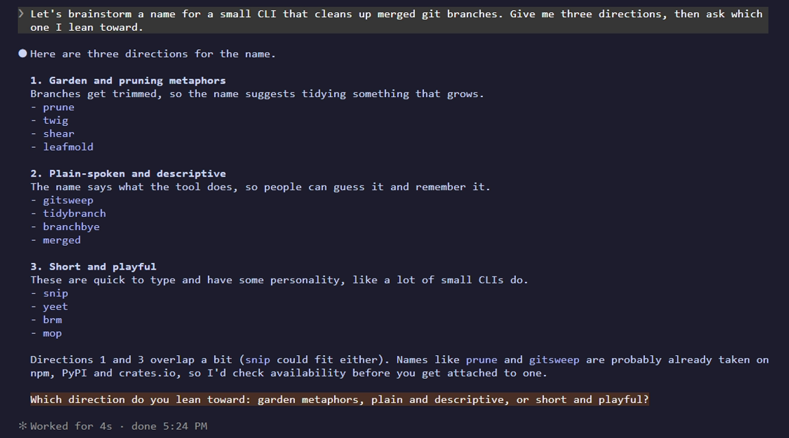

# skim

A Claude Code mod for reading long replies faster.

When Claude explains something at length, it marks the two to four sentences that carry the point. Those
sentences show up highlighted in your terminal and the rest of the reply is dimmed, so you can read the
highlights first and only go through the full text when you need to.

The marks never leave your screen. The mod strips them before the reply is saved, so copies, the transcript
file and Claude's next turn all see plain text.



## Install

```
/plugin marketplace add ttqteo/claude-skim
/plugin install skim@claude-skim
```

Tested on Claude Code 2.1.287 and newer.

## Using it

- Long explanations come out dimmed except for the highlighted sentences.
- Short replies are left alone.
- `/skim` turns the dimming off for the session (you'll see "skim off" in the status area). Run it again to
  turn it back on. Highlights still show either way.

  

- When Claude is brainstorming with you, only the question it is waiting on gets highlighted, and nothing is
  dimmed, so you still read all the options.

  

- In fullscreen mode, if that question has scrolled out of view, a line above the prompt repeats it.

## How it works

The mod adds one short, fixed section to the system prompt asking Claude to wrap must-read sentences in
`==double equals==`. It is about 170 tokens, and since the text never changes it stays in the prompt cache.

On some organization accounts (a Team plan, for one), Claude Code's built-in security plugin keeps user plugins out of the system
prompt. When that happens skim sends the same instructions alongside your prompt instead, hidden from the
transcript: the full text with your first message, then a one-line reminder (about 40 tokens) with each
message after that.

When a reply comes in, the mod pulls the marks out, keeps them aside (keyed by a hash of the cleaned text, so a
resumed session still draws them), and stores the reply without them. The terminal view draws the marked
sentences on a tinted background. There is a cap of 4 marks per reply; past that, or if a mark is very long,
it falls back to plain text, since highlighting everything shows nothing.

Headless runs (`claude -p`) are not asked to mark anything.

## Notes

- The mods API is fairly new and may change between Claude Code releases. If something looks off after an
  update, please open an issue.
- Mods run inside Claude Code with your permissions. This one makes no network calls and runs no commands;
  the code is short, so read it before installing: `plugins/skim/hooks/`.

## Where the code lives

skim started inside arcterm, my cockpit for running coding agents, and it is still developed there. This repo
is the published copy. Issues and pull requests are welcome here and I'll carry them back.

## License

MIT
